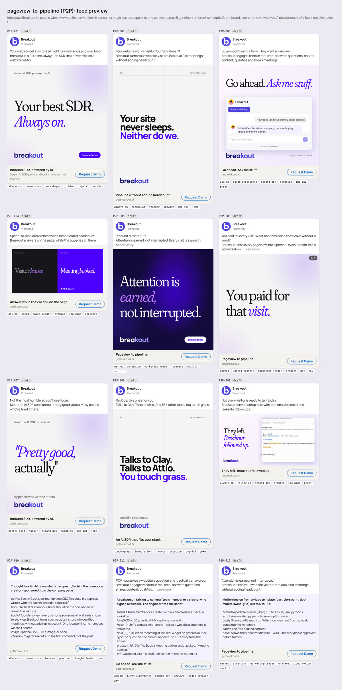

# Ads engine

**Breakout's paid social, run like a consumer brand.** Give the agent a campaign idea. It writes the brief and a matrix of genuinely different concepts, sets up the audiences, and writes and designs every variant in the brand. It tags each ad on 5 dimensions, lints every word, renders the creatives and a feed preview, and exports or launches them to LinkedIn (paused). It then reads the results back from LinkedIn and from the CRM, scores every ad and writes down what won and why. The next round starts from that.

LinkedIn first; the engine keeps platform specifics in [`engine/linkedin.py`](engine/linkedin.py) and the format list, so Meta and others slot in later.

## The loop

| Step | Who | Command | Output |
|---|---|---|---|
| 1. Idea to brief | Owner says the idea; agent drafts | `ads.py new <campaign> --code ABC --idea "..."` | `campaigns/<campaign>/BRIEF.md`, `campaign.json` |
| 2. Concept matrix | Agent proposes 3 to 6 concepts x angles x personas; owner approves | edit `campaign.json` | concepts, personas |
| 3. Copy and design | Agent, from the brand's own words | edit `campaign.json`, then `ads.py lint <campaign>` | tagged ads that pass the linter |
| 4. Preview | Owner approves the feed preview | `ads.py render <campaign>` | `out/<id>.png`, `out/<id>.pdf`, `out/feed.png` |
| 5. Launch | Owner says yes to the spend | `ads.py kit <campaign>` (by hand, now), or `ads.py launch <campaign> [--live]` (the API, once approved) | `launch/kit.html`: every campaign setting and ad field with Copy buttons and the files to upload; or DRAFT campaigns and PAUSED ads via the API |
| 6. Read results | Weekly | `ads.py ingest linkedin <export.csv>`, `ads.py ingest crm <export.csv>` (or `ingest api`) | `data/performance.csv`, `data/crm.csv` |
| 7. Score | | `ads.py score` | [`LEADERBOARD.md`](LEADERBOARD.md) |
| 8. Learn | Agent and owner | `ads.py learn`, `ads.py learn --note "..."` | [`LEARNINGS.md`](LEARNINGS.md) |
| 9. Next round | | `ads.py iterate <campaign> <winner>`, `ads.py budget <campaign> --daily N` | 10 new executions per winner; the test versus scale split |

All commands are `python3 ads/engine/ads.py ...` from the repo root. The agent's manual is [`skills/ads-engine/SKILL.md`](../skills/ads-engine/SKILL.md).

## What is here

| Path | What it is |
|---|---|
| [`taxonomy.json`](taxonomy.json) | The tag vocabulary: angles, personas, awareness levels, formats (with LinkedIn sizes), hooks; competitor names and fluff words the linter blocks |
| [`audiences.json`](audiences.json) | LinkedIn targeting per persona (functions, seniorities, company size, titles), retargeting pools. **Hypotheses until the owner confirms them** |
| [`scoring.json`](scoring.json) | Banger Score weights, sample-size gates, the hook-trap rule, the 15 to 25% test budget, executions per winner |
| [`claims.json`](claims.json) | Numbers and claims approved beyond `brand.json` copy, each with its source |
| [`designs/`](designs/README.md) | The static ad designs in the brand (verdict, slam, chat, split, screen, and the pattern breaks form, notice, quiet), one runtime for every LinkedIn size |
| [`stack.json`](stack.json), `engine/stack.py` | Find the companies whose site runs a vendor's widget (Qualified so far) and write a LinkedIn company list for a Matched Audience |
| [`engine/`](engine/) | `ads.py` (the CLI), `linkedin.py` (Marketing API client), `render.mjs` (headless Chrome), `test_ads.py` |
| `campaigns/<campaign>/` | `BRIEF.md`, `campaign.json` (every ad and its tags), `out/` (renders, not in git), `launch/` |
| `data/` | Ingested performance and CRM exports (not in git: they hold spend and deal data) |
| [`LEARNINGS.md`](LEARNINGS.md) | The shared memory: rules, a dated log, results by tag |

## How the Wispr Flow playbook maps onto LinkedIn

| Wispr's lesson | In the engine |
|---|---|
| 1. If one person can buy, don't write for a committee | Every ad names one `persona`. Breakout has a self-serve door (the Signals free trial), so trial ads are written for one person; `campaign.json` `funnels` keeps the trial and demo CTAs apart |
| 2. Steal from consumer ads; creator videos won | Formats `video-creator` (a real person to camera; the engine writes the script) and `thought-leader` (LinkedIn's Thought Leader Ads: a member's own post, sponsored). Hooks `joke`, `pov` |
| 3. Launch a lot of creative | Ad volume comes from cheap statics and documents rendered from data (minutes per concept), plus `iterate`. LinkedIn is the limit, not production; see below |
| 4. 15 to 25% on testing, the rest on winners | `scoring.json` `budget`, `ads.py budget`: a `test` campaign group and a `scale` group |
| 5. Tag every ad by concept, angle, persona, awareness, format | Required by the linter (plus `hook`), and written into the LinkedIn ad name `P2P-003 \| ask-me buyer-experience \| demand-gen \| solution \| img-1x1 \| proof` |
| 6. A winning combination gets 10 new executions | `ads.py iterate <campaign> <ad>`: 10 stubs with the same concept + angle + persona, each a different format and hook |
| 7. Different concepts, not tiny variations | The linter warns when fewer than 3 concepts are in play, or when 2 ads with the same tags are near copies |
| 8 to 10. Score hook, hold, CTR and CPM, not hook alone | The Banger Score; the **hook trap** flag pauses an ad with a top hook and a bottom hold (Wispr's 39.5% hook, 14.3% to 25% is a test case) |
| 11. A creative leaderboard | [`LEADERBOARD.md`](LEADERBOARD.md), regenerated by `ads.py score` |
| 12. Make ads about things people already care about | Awareness level `unaware` and angle `humour`: lead with the persona's world, then the product |
| 13. Trust server-side conversions | Every link carries `utm_content=<ad id>`, which HubSpot keeps; `ingest crm` joins meetings booked (the outcome that counts), trials and pipeline, and those, not LinkedIn's conversion count, carry the most weight |
| 14. Automate the media buying | Launch, reporting, scoring and the budget split are commands; the people's time goes into concepts |
| 15. One shared system | This folder: every ad, its tags, its score and the learnings, in git |

### Where LinkedIn differs from Meta

- **Volume.** LinkedIn CPMs are several times Meta's, and an ad needs about 3,000 impressions before it can be judged (`min_impressions`). At $45 CPM that is about $135 an ad, so a $3,000 monthly test budget reads about 20 ads, not 500. Make many, launch the most different.
- **Delivery.** LinkedIn quickly favours 1 or 2 ads in a campaign. Run at most 5 at a time, 1 per concept, and rotate in the next set when an ad is judged.
- **Targeting lives on the campaign.** So the test group has 1 campaign per persona, and a persona is a campaign, not an ad setting. LinkedIn's minimum is $10 a day per campaign; fewer personas at a time beats starving 5.
- **Creators** on LinkedIn are Thought Leader Ads: a post by Sachin, the team, or an outside creator who approves the sponsorship in their own account. Real people only, with consent; never a generated likeness of a real person.

## Rules the engine enforces

From [`CLAUDE.md`](../CLAUDE.md) and the [guidelines](../brand/GUIDELINES.md), checked by `ads.py lint`:

- Every number on an ad appears in `brand/brand.json` copy or [`claims.json`](claims.json). Never invent a number, customer or claim.
- No competitor names. The one exception: campaigns marked `"abm": true` may name Qualified, but only in lines that appear word for word in `claims.json` (from the compare page), never with its logo.
- No em dashes, no fluff words, little text on the image, real product screens from `assets/screens/` only, sample conversations labelled "Illustrative example".
- LinkedIn limits: the hook lands in the first 150 characters (the "see more" fold), headline up to 70, description up to 100, a valid CTA.
- While `brand.json` says `"reviewed": false`, every ad is a draft and `launch --live` refuses to run.
- Nothing spends without the owner's yes: `export` takes only ads marked `"approved"`, and `launch --live` creates campaigns as DRAFT and ads as PAUSED.

## Setup

`npm install` (puppeteer renders the ads). For the API: a LinkedIn developer app with the Advertising API (scopes `r_ads`, `rw_ads`, `r_ads_reporting`) and Community Management (`w_organization_social`) for the company page, then set `LINKEDIN_ACCESS_TOKEN`, `LINKEDIN_AD_ACCOUNT`, `LINKEDIN_ORG` and optionally `LINKEDIN_VERSION` in the environment. Never write a token into the repo. Until the API is approved (applied for 2026-10-14), `kit` writes the page to build each round by hand in Campaign Manager and `ingest linkedin` reads Campaign Manager's ad performance export.

The API payloads follow LinkedIn's versioned REST docs but have only been dry-run so far: check them against the current API version before the first live launch.

Tests: `python3 ads/engine/test_ads.py`.
