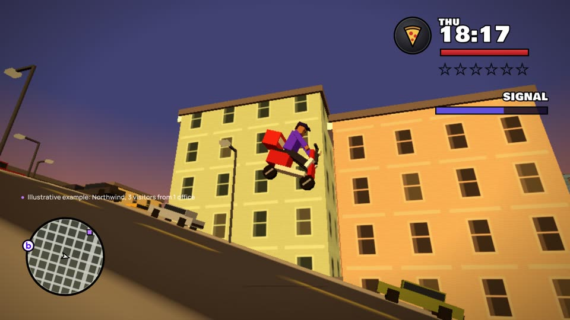

# Open world

A 2004-era open-world game homage: a low-poly downtown San Francisco built in three.js, a third-person hero, a radar that is Breakout, mission titles, objective text and a big mission-passed state; each mission teaches one buying signal and the move that wins it.

| | |
|---|---|
| Use it for | Playful series and social cuts that teach one signal per mission (the signal, the move, the outcome). A mission is about 20 s; two make a 45 s film. |
| Verdict | Round 20, a draft awaiting the owner's verdict. Owner, 2026-10-21: "make a new GTA: San Andreas mission where CJ has to do a series of activities around downtown SF... It has to look and feel like GTA San Andreas", then "I want you to build the game simulation". |
| New video | `python3 scripts/new-video.py open-world <name>`, then edit `film.json` in `videos/<name>/` |

## The genre, never the game

The rights rules (`docs/rights.md`) allow a game's era and genre, never the game itself. This template draws only the genre: low-poly city, haze and grade, a round radar, a clock, a health bar and wanted stars, outlined display type, letterboxed cutscenes, a G-funk bed. It never uses the game's name, logo, characters (the hero is our own, fictional), places, typefaces, sounds or music. The display faces are open: **Bowlby One** for the HUD and the mission-passed state, **Pirata One** for mission titles (SIL OFL, `fonts/`). The radar's north badge is Breakout's b-disc mark, and the close is the real wordmark lockup in the brand fonts.

## The example film

**"Downtown missions"** (draft): golden hour over downtown; the radar wakes; 3 blips in 1 tower. *Pizza for the Buying Committee*: a cooling SIGNAL meter, a moped down the hill, a jump off a terrace, a near miss with a cable car on Market, the committee at the door, "MISSION PASSED! Meeting booked." The clock spins to Monday; the pager: the champion just changed jobs. *Tail the Champion*: a DISTANCE meter that flashes TOO CLOSE, Monday dusk on Market, Wednesday night behind her cable car up the hill, Friday morning at her new office; "MISSION PASSED! New account. Same champion." The city lights violet; the wordmark and "Pageview to *pipeline.*". 44.3 s at 92 BPM, free synthesised score and sound. Story in [`STORYBOARD.md`](STORYBOARD.md); open questions in [`BRIEF.md`](BRIEF.md).

## Make your own

Edit `film.json`:

| Field | What it does |
|---|---|
| `at` | When each beat starts, in bars (open, m1_title, m1_start, ride, m1_pass, m2_title, tail, night, morning, m2_pass, close, end) |
| `missions[]` | Per mission: `title`, the top-left `help` box (the signal), the yellow-style `objective` (`[plain, key word, plain]`), the `meter` name, `passed` and `result` |
| `labels` | The "Illustrative example" lines shown while fictional people and companies are on screen |
| `signs` | The fictional names on the towers and the shop |
| `days` | The clock's day and time for each part of the tail; the light (golden, dusk, night, morning) follows the game clock |
| `lockup.line` | The closing line (`*key*` in lilac) |

The world, the cast, the cameras and the HUD live in `template.html`: `frame(t)` poses everything from `t` and renders it (no render loop, no randomness), so any second can be checked as a still. Change the story's moves there (the ride's route, the tail, the shots); change the words in `film.json`.

| File | What it does |
|---|---|
| `build.py` | `film.json` + `brand.json` -> `index.html`, `compositions/world.html` (copies three.js, GSAP and the fonts into `assets/`) |
| `score.py` | The G-funk bed, synthesised in numpy (no samples, no soundfont) -> `score/score.wav` |
| `audio.py` | The game's sound (engine, bell, radar, pager, squeal, city), the -14 LUFS mix and the mux |
| `render.sh` | All of it -> `renders/<folder>.mp4` |

Stills: `npx -y hyperframes@0.8.77 snapshot --at 2,12.9,19 --describe false` after `build.py`. The renderer falls back to software WebGL on machines without a GPU; a 45 s film then takes several minutes.
