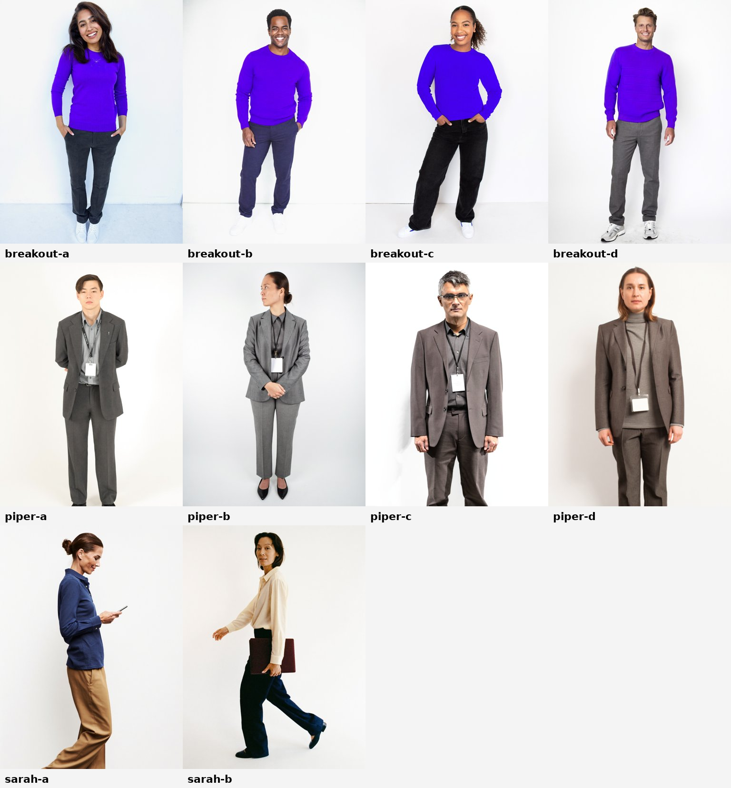

# two-hander

Two generated people on a white seamless, talking: Breakout and a rival, cut on the dialogue, with a verbatim claim card per joke, subtitles for muted autoplay, and the Breakout end card. The genre of the classic two-person comparison ads, never their lines, music or casting.

**Verdict:** requested by the owner (2026-10-27) for the Breakout vs Piper series; awaiting a verdict.

## The example

The pilot "Breakout vs Piper" (about 46 s): Breakout (young, warm, a violet crewneck) and Piper, Qualified's AI SDR (the straight man, in grey). The Pied Piper, go-live, buying signals, Sarah from Vanta walking past, the hand-raise, then the logo and "Pageview to *pipeline.*". Story in [`STORYBOARD.md`](STORYBOARD.md), claims and rules in [`BRIEF.md`](BRIEF.md).

## How it is made

1. **Cast** on Higgsfield (Soul 2.0 stills, a few options per role, then one 2-shot of the chosen pair with Nano Banana Pro and both stills as references). Prompts in `cast/prompts.json`, job ids and URLs in `cast/jobs.json`; the PNGs stay out of git and `build.py` fetches them again when missing.
2. **Voices** on Higgsfield `text2speech_v2`: cast every preset voice on 1 line (`skills/launch-voice/scripts/hf_voice.py cast`), shortlist by ear, then 1 file per line (`hf_voice.py lines lines-breakout.json vo/breakout-lines --voice Liza`). The takes live in `vo/` (git-ignored).
3. **Animatic** (free): `./render.sh` builds the stills, the real lines, the cuts, the cards and the end card into `renders/two-hander.mp4`. Judge the timing here.
4. **Footage** (paid, after the animatic is approved and the cost is stated): generate each beat as video from the 2-shot and the singles with the lines as audio references, then swap the stills for the clips.

## Files

| File | What it does |
|---|---|
| `film.json` | The cast, the voices, the beats: each line's speaker, take, text, gap and frame (`two`, `breakout`, `piper`), the claim cards, Sarah's cross, the end line |
| `template.html` | The shots (a hard cut per change of frame, a slow push while it holds), the name tags, claim cards, source line, subtitles and end card; every frame is a pure function of time |
| `build.py` | film.json + the lines' real lengths + brand -> `index.html`, `compositions/`, `assets/`, `timing.json`; mattes the cut-outs off the white seamless (free) |
| `audio.py` | The lines at their times on a quiet room tone, -14 LUFS, -1 dBTP, muxed onto the picture |
| `render.sh` | Build, render and mix in one go |
| `lines-*.json` | The script, 1 file per character, for `hf_voice.py lines` |

## Rules this style keeps

- Dialogue is the one place a Breakout film has voices; there is still no narrator.
- Every joke is a verbatim, dated claim (`BRIEF.md`), shown on a card with its source while it is up.
- Qualified and Piper by name only: no logo, colours, UI, staff or Piper's own character. Example people and companies are labelled "Illustrative example".
- On-screen text is markup, never generated inside the footage.
