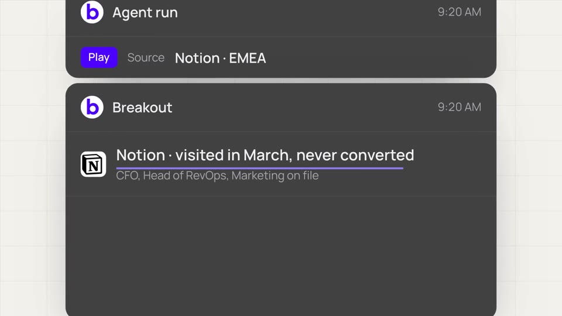

# Plays launch: "Signal in. Pipeline out."

The Plays launch film, made from the [`swiss-grid`](../../templates/swiss-grid/README.md) template (its example, approved: "This is great."), iterated on 2026-11-19.

**Before sharing:** the soundtrack is a commercial track the owner supplied (Sébastien Léger, "After That (Original Mix)"). Internal review only until it is licensed for this use ([`docs/rights.md`](../../docs/rights.md)). The mp3 lives in `music/`, which git ignores; put it back there to rebuild.

## Changes from the template's example

Owners notes, round 1: "1\ Remove the Breakout plays small text entirely 2\ Reword to "Signal in. Pipeline out." 3\ Zoom in, slow a little on the changes we detect (New CFO hired, Pricing page viewed etc) 4\ Add this song to the soundtrack instead. Keep the sfx"

| | |
|---|---|
| Small text | Gone: the "Breakout · Plays" tag, the index breadcrumbs ("01 / Signal"...), the timecode, "Illustrative example" and the labels under the email |
| Just the cards | The words beside the cards ("Reads.", "Thinks.", "Sends.", "Books.") are gone; the cards sit centred (the camera frames them at the centre; during the email, cards and email are centred as a pair) |
| Lockup | "Signal in. *Pipeline out.*" |
| The account and the detected changes | The account line carries the Notion mark (`media/account-mark.png`, cropped from the logo the owner supplied) and an underline that draws under it while the camera holds (2.1x to 2.2x); then the camera snaps in on "2 blog views" (2.7x) and on "New CFO hired" (2.7x) as each appears, and pulls back for the three rows and their Act pills. Bars 2.7 to 3 play at a third of the speed, bars 3 to 4 at 1/2.4 (`warp.segments` in `film.json`): two extra bars, so later cuts stay on the song's downbeats |
| Music | The owner's track at its own 126 BPM (the film moved from 128 to 126), from its very first beat (0.249 s) on bar 0; faded out under the lockup. Cuts land on its beats |
| Sound effects | Kept, retimed through the slowed bar |

28.6 s. `./render.sh` -> `renders/signal.mp4`.

Round 2 (owner): "remove the "reads", "thinks" etc text from the right and center align the cards so its just the cards with no text. Remove stuff like illustrative example, breadcrumbs. Start the soundtarck fromt he beginnng of the soundtrack"

Round 3 (owner): "the "notion visited in march" -> Add the notion logo there + underline that/spend time there. Then zoom in on 2 blog views, zoom in on new CFO hired, when those appear."

**Real company:** Notion is a real company; the card's facts about it (visited in March, never converted, a new CFO, pricing page viewed 3×) are illustrative, and its logo is now shown. With the commercial soundtrack, this cut is internal only; for anything public, swap the account to a fictional one (`agent.account` in `film.json`).
