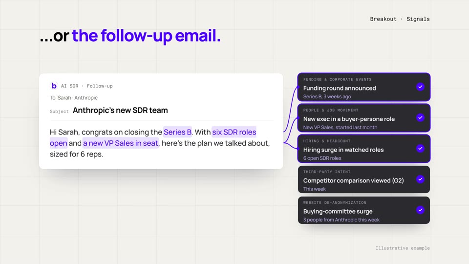

# Signals launch

A 48.8 s launch film for Signals, made from the [`swiss-grid`](../../templates/swiss-grid/README.md) template: a visitor on a pricing page, Breakout listening to 35+ signals, the intel arriving next to the cursor one signal at a time, then the website agent and the AI SDR email using it.

**Before sharing:** the visitor is Anthropic, by the owner's choice, with illustrative findings; see [`BRIEF.md`](BRIEF.md). Not for public posting as is.

| | |
|---|---|
| Story | [`BRIEF.md`](BRIEF.md), [`STORYBOARD.md`](STORYBOARD.md) |
| Data | `film.json`: every word and every time (`at`, in bars): headlines, the visitor (`visitor.logo` in `media/`), the pricing page, the five signal cards, the agent's message and the email (`[key]phrase[/key]` marks the words a card shaped), the lockup |
| Look | `template.html`: the page, the cursor and its tag, the loading cards, the chat, the email and the wires; `draw(t)` sets every frame |
| Sound | `score.py` (upbeat swing), `audio.py` (cues from `at`, the mix, the mux) |
| Render | `./render.sh` -> `renders/signals-launch.mp4` |
